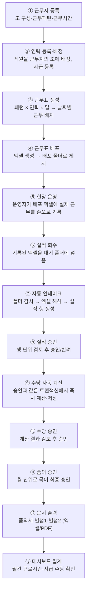

# 01. 제품 개요와 업무 흐름

> 이 프로그램이 무엇을 하는지, 업무가 어떤 순서로 흘러가는지 정리한다.
> **새 화면을 설계하기 전에 이 문서를 먼저 읽어야 한다.** 화면은 이 흐름을 담는 그릇이다.

---

## 1. 한 문장 정의

**교대근무 사업장의 근무표를 만들어 배포하고, 실제로 일한 실적을 엑셀로 회수해 승인하고, 그에 따른 연장·야간·휴일·대체 수당을 계산해 품의서와 별첨 서류를 만들어 내는 윈도우 프로그램.**

- 사용자: 비기술 한국어 운영자(현장 운영자·사장). 개발 지식 없음.
- 설치 대수: 사무실 PC 소수. 데이터는 각 PC 안에 저장(서버 없음).
- 실제 파일 작업 폴더: `C:\연장근무실적\` (배포관리 / 품의서 / 별첨1 …)

---

## 2. 업무 전체 흐름 (엔드투엔드)



### 흐름의 3개 큰 덩어리

| 덩어리 | 화면 | 데이터가 만들어지는 곳 |
|---|---|---|
| **준비** (①②) | 근무지 관리 · 인력 관리 | `sites`, `shift_patterns`, `employees`, `employee_site_assignments`, `wage_rates` |
| **운영** (③~⑨) | 근무표 배포 · 실적 관리 | `monthly_schedules`, `performance_files`, `performance_entries`, `performance_approvals`, `allowance_calculations` |
| **정산** (⑩~⑬) | 수당 관리 · 대시보드 | `allowance_approvals`, `allowance_proposal_approvals`, `allowance_document_exports` |

---

## 3. 단계별 상세

### ① 근무지 등록 (근무지 관리 화면)
2단계 마법사로 진행한다.

**1단계 — 패턴 등록**: 근무지 기본 정보(이름·고객사·상태) → 조 개수(2~8) → 근무 유형 팔레트(주간·야간·휴무 등, 근무형은 최대 3개) → 조별 근무 패턴(클릭 페인팅) → 근무시간·휴게시간 → 조별 인력 명단.
- 조마다 전용 패턴을 줄 수도 있고(**조별 개별 패턴**), 여러 조가 하나의 패턴을 며칠씩 밀어 쓸 수도 있다(**공유 묶음**).
- 우측에 3개월 시뮬레이션 달력이 실시간으로 그려진다.
- **설정 적용 시작일**을 지정하면 그 날짜부터 새 규칙이 적용되고, 과거 근무는 이전 버전 규칙으로 계산된다(버전이 쌓임).

**2단계 — 조직 구성**: 직원을 조에 끌어다 배정, 조별 정원 관리, 배정 시작일 지정.

### ② 인력 관리
직원 등록(사번·이름·직급·고용형태·입사일), **시급 등록(적용일 기준으로 이력이 쌓임, 과거 날짜 소급 가능)**, 근무지 배정 이력, 시급 엑셀 일괄 적용.

### ③④ 근무표 생성·배포 (근무표 배포 화면)
근무지 + 달을 고르면 패턴과 배정 인력으로 **날짜별 근무표 초안**을 자동 생성한다. 미리보기 확인 후 엑셀로 만들어 배포 폴더에 게시한다. 배포 이력이 기록된다.

### ⑤⑥⑦ 실적 회수와 인테이크
운영자가 배포된 근무표 엑셀에 실제 근무(대체 투입, 연장, 휴일근로 등)를 기록해 **대기 폴더**에 넣는다. 프로그램이 폴더를 감시하다가 새 파일을 발견하면 자동으로 해석해 **실적 행**으로 만든다.
- 해석 규칙이 매우 복잡하다 → `06-excel-io.md`
- 실적은 **반드시 이 경로로만** 들어온다. 화면에서 직접 입력하는 기능은 없다(의도된 설계).

### ⑧⑨ 실적 승인 + 수당 계산 (실적 관리 화면)
근무지별로 묶인 실적 행을 검토해 승인한다.
- 승인하는 순간 **같은 트랜잭션 안에서 수당이 계산돼 저장된다.** 승인만 되고 계산이 빠지는 상태는 존재할 수 없다.
- 이미 승인된 파일이 수정돼 다시 들어오면 **재승인 흐름**을 탄다.
- 반려·되돌리기·행 숨김 기능이 있다.

### ⑩⑪⑫ 수당 승인과 문서 출력 (수당 관리 화면)
계산된 수당을 검토·승인하고, 월 단위로 묶어 품의 승인을 한다. 승인 시 **품의서·별첨1·별첨2**가 등록된 양식에 채워져 엑셀(또는 PDF)로 출력된다.
- 조기 지급일 지정 기능이 있어 정규분/조기지급분이 나뉜다.

### ⑬ 대시보드
월간 근로시간·지급 수당을 법정휴일/대체근무/연장근무로 나눠 집계하고, 인원별 순위와 차트를 보여준다. 차트 데이터·보고서 내보내기 가능.

### 부속 화면
- **운영 관리**(관리자 전용): 폴더 경로 설정, 공휴일 달력, 수당 요율표, 사용자·권한, 문서 양식 등록/편집, 데이터베이스 백업·복원·이관, 릴리즈 이력.
- **활동 이력**(관리자 전용): 로그인·화면 이동·주요 처리 기록.

---

## 4. 용어집 (운영자 말 ↔ 데이터 용어)

| 운영자가 쓰는 말 | 프로그램 안 이름 | 설명 |
|---|---|---|
| 근무지 / 사이트 | `site` | 관리 단위 사업장 |
| 조 (A조, B조…) | `team` / `teamLabel` / `shiftGroup` | 교대 그룹 |
| 근무 묶음 / 사이클 | `cycle` | 하나의 반복 근무 패턴 단위. 여러 조가 공유할 수도, 조마다 전용일 수도 |
| 근무 유형 | `dutyType` | 주간·야간·석간·휴무·비번 등. 근무형(시간 있음) 최대 3개 |
| 패턴 | `patternString` / `steps` | "주주야야휴휴" 처럼 반복되는 근무 나열 |
| 조 시작 위치 | `teamIndex` | 같은 패턴을 조마다 며칠씩 밀어서 시작하는 값 |
| 설정 적용 시작일 | `effectiveFrom` | 이 날짜부터 이 설정으로 계산. 과거는 이전 버전 유지 |
| 근무표 | `monthlySchedule` | 달 단위 날짜별 근무 배치 |
| 배포 | `publish` | 근무표 엑셀을 배포 폴더에 게시 |
| 실적 | `performance` | 실제로 일한 기록 |
| 승인대기 파일 | `pending file` | 대기 폴더에 들어와 아직 승인 안 된 엑셀 |
| 변경전 / 변경후 칸 | 그리드의 정규/변경 슬롯 | 근무표에서 근무자가 바뀐 것을 표시하는 칸 |
| 대체근무 | `substitute` | 남의 근무에 대신 투입된 근무 |
| Pool / 별도 근무 | `POOL` 근무유형 | 교대 회전에 속하지 않는 인력. 대체수당 미지급 |
| 주간고정조 | `FIXED_DAY` | 주간만 고정 근무하는 조. 대체수당 미지급(적용 시작일 이후) |
| 교대조 | `ROTATING` | 정상 회전 교대조. 대체수당 지급 대상 |
| 요율 / 배율 | `multiplier` | 시급에 곱하는 값(예: 1.5배) |
| 품의서 | `proposal` | 수당 지급 결재 문서 |
| 별첨1 / 별첨2 | `attachment1/2` | 품의서에 붙는 인원별·근무별 명세 |
| 조기 지급 | `earlyPayout` | 정규 지급일보다 먼저 지급하는 건 |

---

## 5. 권한 체계

역할은 4개다. 🔴 **계단식이 아니다.** 계획 담당(`planner`)과 승인 담당(`reviewer`)은 **서로 상하 관계가 아닌 형제 역할**이고, 관리자(`admin`)만 전체 권한을 가진다.

```
                 admin  (전부 가능)
                /     \
        planner         reviewer     ← 서로 상하 관계가 아니다. 형제다
                \     /
                operator  (기본 권한 + 아래 주(註)의 실행 창구)
```

| 역할 | 코드 | 접근 가능 화면 | 가능한 작업 | 🔴 할 수 **없는** 작업 |
|---|---|---|---|---|
| 사용자 | `operator` | 대시보드·인력·근무지·근무표·실적·수당 | 조회 + 아래 주(註)의 실행 창구 | **인력·근무지·근무패턴 등록/수정**(`employee-write`·`site-write`·`shift-pattern-write`), **근무표 저장·배포·게시**(`schedule-deploy`), **실적 승인**(`performance-approval`), **수당·품의 승인**(`allowance-approval`) |
| 계획 담당 | `planner` | 위와 동일 | + 인력·근무지·근무패턴 등록/수정, 근무표 저장·배포·게시 | ❌ **실적 승인·수당 승인·품의 승인** |
| 승인 담당 | `reviewer` | 위와 동일 | + 실적 승인·반려·되돌리기·재승인 확정·행 숨김, 수당 검토·품의 승인 | ❌ **인력·근무지·패턴 등록/수정, 근무표 배포** |
| 관리자 | `admin` | 전체 + **운영 관리**, **활동 이력** | 전부 | — |

> **주(註) — `operator`도 실행할 수 있는 창구가 있다.**
> 수당 계산 실행(`allowance:run-approved-calculation`), 조기 지급일 지정, 문서 재출력, 시급 일괄 **미리보기**, 시작 시 자동 복구 재시도는 로그인만 되어 있으면 전 역할이 실행한다. 소스의 실제 동작이므로 화면에서 임의로 막지 않는다.
> 창구 111개의 권한 경계 정본은 `12-능력-매트릭스.md` §4.2다.

🔴 **화면 설계에서 "승인 담당 이상" 같은 계층 표현을 쓰지 않는다.** 상하 관계가 없으므로 뜻이 성립하지 않는다. **역할을 직접 열거**한다.

- 로그인 필수. 초기 계정은 admin, 최초 로그인 시 비밀번호 강제 변경.
- 계정 잠금(실패 횟수), 관리자 계정 복구키 발급 기능 있음.
- 원본 정의: `src/shared/domain/authorization.ts` (**그대로 이관**)

### 5.1 이 절의 정정 이력

| 날짜 | 정정 내용 | 사유 |
|---|---|---|
| 2026-08-28 | **"역할 4단계. 상위 역할은 하위 역할 권한을 포함한다"를 삭제**하고 형제 관계로 바로잡음. 역할별 "할 수 없는 작업" 열 추가 | 실제 소스 `src/shared/domain/authorization.ts:11-16`의 `roleRequirementSatisfaction`에서 `planner` 요구는 `["planner","admin"]`, `reviewer` 요구는 `["reviewer","admin"]`으로 **서로를 포함하지 않는다.** 이 문서는 설계 전에 먼저 읽는 기준 문서이므로, 정정 사실을 다른 문서에만 적으면 기준이 둘로 갈라진다 (Codex 4차 교차검증 B7) |

---

## 6. 새 화면 설계자가 알아야 할 성격

1. **데이터가 많다.** 한 달 실적이 수백~수천 행. 표 중심 화면이 많고, 필터·검색·그룹핑이 실사용에 필수다.
2. **되돌릴 수 없는 동작이 많다.** 승인·배포·품의 승인은 되돌리기 어렵다. 확인 단계가 반드시 필요하다.
3. **사용자가 비기술자다.** 오류 메시지도 "무엇을 하면 되는지"까지 한국어로 알려줘야 한다.
4. **가짜 UI 금지 원칙이 있다.** 실제 데이터·동작이 없는 장식 요소(전화 버튼, 가짜 건수, 증명사진 등)는 시안에 있어도 만들지 않는다. → `09-design-brief.md`
