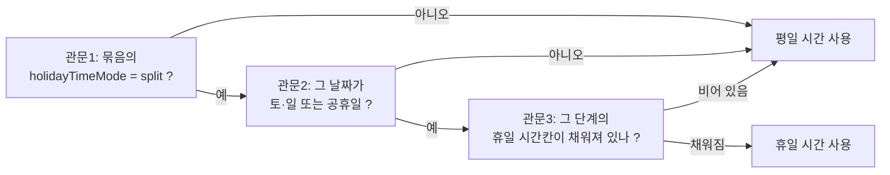

# 02. 업무 규칙 명세 (계산·판정)

> **이 문서의 규칙은 새로 구현하지 않는다.** 원본 코드를 그대로 옮긴다.
> 이 문서는 "무엇이 어디에 있고 왜 그런지"를 설명해, 이관 후 검증할 때와 나중에 규칙을 바꿔야 할 때 쓰는 참조서다.
>
> 모든 원본은 `src/shared/domain/`에 있다. 이 폴더는 **화면·데이터베이스와 무관한 순수 계산 코드**라서 그대로 이식된다.

---

## 0. 이관 대상 모듈 목록 (30개)

| 모듈 | 역할 | 크기 |
|---|---|---|
| `calculation.ts` | 근무시간 분해(기본·연장·야간) | 5.8KB |
| `allowance-service.ts` | 수당 금액 계산·스냅샷 | 5.8KB |
| `allowance-rate-matrix.ts` | 요율표(5×3)·카테고리 판정 | 5.7KB |
| `allowance-rate-service.ts` | 근무일에 적용할 요율 버전 선택 | 1.2KB |
| `allowance-rate-impact.ts` | 요율 변경 시 영향 건수 | 3.8KB |
| `allowance-workflow.ts` | 수당 승인 상태·품의 모델 | 2.7KB |
| `allowance-document.ts` | 문서 출력 형식 | 1.8KB |
| `rounding.ts` | 원 단위 처리 | 0.2KB |
| `monthly-schedule-draft.ts` | 근무표 자동 생성 | 15.7KB |
| `rotation-index.ts` | 회전 위치 계산 | 2.1KB |
| `shift-pattern-compression.ts` | 패턴 문자열 해석 | 14.3KB |
| `shift-pattern-version.ts` | 설정 적용 시작일·버전 | 5KB |
| `duty-type-catalog.ts` | 근무유형·자동 휴게 | 9.4KB |
| `substitute-allowance-policy.ts` | 대체수당 지급 판정 | 5.5KB |
| `changed-slot-priority-policy.ts` | 변경후 칸 우선 규칙 | 1.6KB |
| `team-work-type.ts` · `team-label.ts` · `team-membership.ts` | 조 식별·근무유형 | 7.4KB |
| `performance-file.ts` | 실적 행 모델·미지급 판정 | 12.4KB |
| `schedule-rule-warning.ts` | 근무표 규칙 위반 경고 | 9.2KB |
| `site-pattern-detection.ts` | 엑셀에서 패턴 역추출 | 6.2KB |
| `employee-rank.ts` · `employment-type.ts` | 직급·고용형태 | 2.4KB |
| `authorization.ts` | 권한 | 1.9KB |
| `model.ts` | 전체 데이터 타입 | 8.6KB |
| 그 외 | `access-log`, `app-update`, `database-migration`, `document-template`, `schedule-plan` | — |

---

## 1. 시간 계산 기초

### 1.1 시각 해석
- 형식 `"HH:mm"` 고정. 벗어나면 **예외를 던진다**(조용히 0으로 만들지 않는다).
- 종료가 시작보다 작거나 같으면 **다음 날로 본다**(자정 넘김). `19:00 - 07:00` = 12시간.

### 1.2 실근무시간
```
실근무 = max(원시간 − 휴게, 0)
```

### 1.3 법정 자동 휴게 (`duty-type-catalog.autoBreakMinutes`)
```
휴게 = floor(근무분 / 240) × 30       // 4시간마다 30분
```
- 4시간 미만이면 0.
- 사용자가 손으로 고치면 `isBreakDirty = true`가 되어 **자동 재계산이 멈춘다**(사용자 값 보존).

---

## 2. 근무시간 분해 — `calculation.calculateWorkBreakdown`

수당 계산의 출발점. 하나의 근무를 **기본/연장/야간/휴일/대체** 분으로 쪼갠다.

### 2.1 상수
```
기본근로 한도    = 480분 (8시간)
야간 시간대      = 22:00 ~ 06:00
```

### 2.2 계산 순서 (순서가 결과를 바꾸므로 그대로 유지할 것)

1. **총 실근무분** = 실근무시간
2. **야간 겹침분** 계산 — 22:00~24:00, 00:00~06:00, 그리고 자정 넘긴 다음 날 00:00~06:00 세 구간의 겹침 합
3. **야간분 보정** = `max(야간겹침 − min(야간겹침, 휴게), 0)` — 휴게를 야간에서 먼저 뺀다
4. **야간분** = `min(총 실근무분, 보정 야간분)`
5. **비야간분** = `총 − 야간분`
6. **기본 여력** = `max(480 − 야간분, 0)` — **야간이 기본 한도를 먼저 잡아먹는다**
7. **기본분** = `min(비야간분, 기본 여력)`
8. **연장분** = `max(비야간분 − 기본분, 0)`

### 2.3 근무 종류별 예외

| 근무 종류 | 동작 |
|---|---|
| `holiday` (법정휴일 직접근무) | **쪼개지 않는다.** 야간 0, 연장 0, **전부 기본분**. 휴일 요율이 이미 가산을 포함하기 때문 |
| `overtime` (연장근무) | 기본 여력 0 → 기본분 0, 비야간분 전부가 연장분 |
| `substitute` (대체근무) | 일반 규칙 그대로. **연장·야간 가산이 살아 있다** |
| 그 외 | 일반 규칙 |

### 2.4 부가 값
- `holidayMinutes` = 휴일 판정이면 총 실근무분, 아니면 0
- `substituteMinutes` = 대체근무면 총 실근무분, 아니면 0
- 이 둘은 **집계·표시용**이며 금액 계산에는 직접 쓰이지 않는다(금액은 기본·연장·야간 3축으로만).

---

## 3. 수당 요율표 — `allowance-rate-matrix.ts`

### 3.1 구조: 5개 업무 구분 × 3개 축

| 업무 구분(코드) | 한국어 | 기본 | 연장 | 야간 |
|---|---|---|---|---|
| `legal-holiday` | 법정공휴일 | 1.5 | 1.5 | 1.5 |
| `weekday-substitute` | 평_대체근로수당 | 1.5 | 2.0 | 2.5 |
| `holiday-substitute` | 휴_대체근로수당 | 1.5 | 2.0 | 2.5 |
| `weekday-overtime` | 평_연장근로수당 | **0** | 1.5 | 2.0 |
| `holiday-overtime` | 휴_연장근로수당 | **0** | **0** | **0** |

*위 값은 기본값이며, 운영 관리 화면에서 연도·적용기간별 버전으로 덮어쓸 수 있다.*

> `weekday-overtime`의 기본 배율이 0인 이유: 연장근무는 정규 근무시간 외의 추가분이므로 기본급 부분은 이미 급여로 지급됨. 가산분만 계산한다.
> **2026-11-08 사용자 확정:** 공휴일의 추가 연장근무도 별도로 지급하며, 해당 날짜의 성격에 맞는 요율 관리의 배율을 쓴다. 위 휴일 연장 0은 초기값일 뿐 지급 제외 규칙이 아니다. 운영 배율을 임의로 정하지 않는다. 실제 근무가 있는데 적용 배율이 모두 0이면 `ALLOWANCE_RATE_ZERO_AMOUNT`로 승인을 보류한다. 일반 토·일은 공휴일 목록 등록 여부를 따르는 현재 분류를 유지한다.

> **후속 승인:** 실제 근무분이 있는 축(기본·연장·야간) 중 하나라도 0 또는 유효하지 않은 배율이면 신규 승인·수당 미리보기를 중단한다. 다른 축의 금액이 양수인 부분 지급도 `ALLOWANCE_RATE_INCOMPLETE`로 차단한다. 근무분 0인 축은 0배율을 허용한다. 순수 산식/영향도 비교의 0배율 가정과 과거 승인 원문은 보존한다.

공휴일 동기화는 우측 미리보기 조회와 ‘적용하기’ 저장을 분리한다. 선택 연도의 같은 날짜는 갱신하고 새 날짜는 추가하며, 기존 목록에만 있는 수동 날짜는 유지한다. 조회 실패·잘못된 자료·최신성 불일치에서는 기존 DB를 보존한다. 기본 출처는 Nager와 Google 대한민국 공휴일 일정이며 원 공휴일·대체일을 함께 보존하고 기념일은 제외한다. 보완 일정이 제공되지 않는 연도는 불완전한 목록을 저장하지 않고 안내한다.

공휴일 수당의 날짜 여부는 DB 목록으로 판단한다. 일반 토·일의 정규 편성은 공휴일 수당을 만들지 않으며, 별도의 연장·대체 실적은 기존 분류를 따른다. 평일 공휴일은 공휴일 시간, 토·일과 겹친 공휴일은 해당 요일 시간을 적용하고 요율은 공휴일 요율을 유지한다. 시간 변경만 적용하며 기존 편성·사이클·명시적 날짜 예외를 보존한다. 미설정 시간은 기존 선택으로 돌아가고 명시적 휴무·0분은 임의 근무로 보충하지 않는다.

### 3.2 업무 구분 판정 — `resolveAllowanceRateCategoryCode`

우선순위대로 검사한다(먼저 걸리는 것이 이김).

1. 엑셀의 구분 텍스트에 **"휴_대체"** 포함 → `holiday-substitute`
2. **"평_대체"** 또는 **"대체"** 포함 → 휴일이면 `holiday-substitute`, 아니면 `weekday-substitute`
3. **"휴_연장"** 포함 → `holiday-overtime`
4. **"평_연장"** 또는 **"연장"** 포함 → 휴일이면 `holiday-overtime`, 아니면 `weekday-overtime`
5. **"법정공휴일/법정휴일/공휴일/휴일근로/휴일"** 포함 → `legal-holiday`
6. 텍스트가 없으면 근무 종류로: `substitute` → 대체 계열, `holiday` → `legal-holiday`, 휴일 판정 → `legal-holiday`
7. 아무것도 안 맞으면 → `weekday-overtime` (안전한 기본값)

*비교 전에 공백을 모두 제거하고 소문자로 만든다.*

### 3.3 요율 버전 선택 — `selectApplicableAllowanceRateVersion`
- **근무일(workDate) 기준**으로 고른다. 계산 시점이 아니다.
- 상태가 `active`이거나 종료일이 명확한 `retired`이고, `effectiveFrom ≤ 근무일 ≤ effectiveTo`인 버전 중 **시작일이 가장 늦은 것**. 활성 버전의 종료일 미지정은 계속 적용을 뜻한다. 초안·적용 기간 미상의 종료 버전·잘못된 날짜는 제외한다.
- 해당 버전이 없으면 계산을 **거부**한다(오류 `ALLOWANCE_RATE_NOT_FOUND`). 미래·다른 연도·임의 기본값으로 넘어가지 않는다. 같은 시작일의 선택 후보가 둘이면 모호한 중복으로 거부한다.
- 새 적용 버전 저장 시 앞 버전의 종료일은 새 시작일 전날로 정리하고, 뒤 버전이 있으면 새 종료일은 그 시작일 전날까지다. 미래 버전 저장 때문에 현재 버전을 일괄 만료시키지 않는다. 종료 기간 미상인 과거 자료는 추정해 복구하지 않는다.

### 3.4 수당 지급 대상 게이트 — `DEC-001` (2026-09-19 사용자 결정)

- **Pool 인력은 근무 유형과 무관하게 수당 지급 대상이 아니다.** 대체근무뿐 아니라 법정휴일·연장근무도 승인·계산 대상에서 제외한다. 판정은 실적의 `is_pool_worker`, 근무일 당시 Pool 조 배정, 또는 이름의 `(P)` 표식을 함께 사용한다.
- **BP 인력은 수당 지급 대상이 아니며 실적·수당 범위에 포함하지 않는다.** 인력·근무표에는 존재할 수 있지만 승인·수당 행은 만들지 않는다.
- 지급 가능한 실적은 **비어 있지 않은 사번**이 필수다. BP는 외부 사번 없이 인력·근무표에 존재할 수 있는 유일한 예외지만, 바로 위 규칙에 따라 실적·수당에는 들어오지 않는다.
- 사번 없는 비BP 실적은 새 인테이크에서 저장하지 않고 제외 사실을 경고로 남긴다. 과거 JSON의 미승인·미계산 행은 원본 백업을 바꾸지 않고 V4 복원 대상에서만 제거한다.
- 사번 없는 과거 행에 승인·계산·숨김 등 금액/결재 이력이 연결돼 있으면 자동 삭제하지 않고 복원을 중단한다. 이미 승인·계산된 결과는 이 규칙으로 삭제하거나 재계산하지 않는다.

---

## 4. 수당 금액 계산 — `allowance-service.ts`

### 4.1 계산식
```
라인 원금액 = (시급 × 근무분 × 배율) ÷ 60
```
기본·연장·야간 3개 라인을 만든다. **근무분이 0이거나 배율이 0이면 라인 자체를 만들지 않는다.**

### 4.2 원 단위 처리 (중요 — 그대로 이관)
```
총액   = ceil(모든 라인 원금액의 합)         // 실적별 정확한 십진 유리수 올림
라인별 = floor(각 라인 원금액)                // 내림
잔여   = 총액 − 라인별 합
```
잔여 금액은 **소수부가 큰 라인부터 1원씩 분배**한다(소수부가 같으면 라인 순서).

> 왜 이렇게 하나: 라인을 각각 반올림해 더하면 총액과 안 맞는다. **총액을 먼저 확정**하고 라인에 나눠 담아야 품의서 합계와 별첨 명세 합계가 1원도 안 어긋난다.

### 4.3 시급
- 실적 행에 이미 확정돼 저장된 시급을 쓴다. 시급이 없거나 0 이하면 계산 **거부**(`ALLOWANCE_HOURLY_RATE_REQUIRED`).
- 시급 이력은 **근무일 기준 소급 적용**된다. 과거 날짜로 시급을 등록할 수 있고, 같은 날짜면 덮어쓰며, 앞뒤 기간이 자동 정리돼 겹치지 않는다.
- **이미 승인된 계산은 시급이 바뀌어도 그대로**다(스냅샷 보존).
- **W06/W08 후속 승인 반영:** 인테이크에서 근무일 시급을 저장하고, 인력 시급을 변경하면 연결된 미승인 실적의 시급을 자동으로 다시 읽는다. 이미 승인된 계산은 변경하지 않는다. `workforce-wage-performance-service.ts`가 새로고침을 담당한다. 0-17의 수동 재읽기 설명은 후속 기능 이전의 역사적 기준이다.
- 같은 적용일 정정은 현재 시급 줄을 바꾸며 이전 금액·사유를 `same-date-replaced` 이력으로 보존한다. 다른 적용일은 앞뒤 기간을 정리한다. 기존 승인 스냅샷·정책 적용일과 과거 취소 전 원문은 자동 수정하지 않는다.

### 4.4 서명(signature)
계산 결과는 JSON 문자열로 서명을 만들어 **DB에 UNIQUE 제약**으로 저장한다. 같은 승인건이 같은 내용으로 두 번 계산되는 것을 데이터베이스가 막는다.

---

## 5. 대체근무수당 지급 판정 — `substitute-allowance-policy.ts`

**조 이름이 아니라 조의 근무유형으로 판단한다.**

### 5.1 조 근무유형 3종
| 코드 | 뜻 |
|---|---|
| `ROTATING` | 정상 회전 교대조 |
| `FIXED_DAY` | 주간고정조 |
| `POOL` | 교대 회전에 속하지 않는 별도 인력 |

### 5.2 판정 순서
1. 관리자 수동 제외 → **미지급** (`MANUAL_EXCLUSION`)
2. 대체 **대상**(원 근무자)이 `ROTATING`이 아님 → **미지급** (`TARGET_IS_NOT_ROTATING_SHIFT`)
3. 본인의 정규근무임(추가근무 아님) → **미지급** (`NOT_ADDITIONAL_WORK`)
4. 대체 **투입자**가 `POOL` → **미지급** (`POOL_SUBSTITUTE_EXCLUDED`)
5. 대체 **투입자**가 `FIXED_DAY` → **미지급** (`FIXED_DAY_SUBSTITUTE_EXCLUDED`)
6. 대체 **투입자**가 `ROTATING` → **지급** (`ROTATING_SUBSTITUTE_ELIGIBLE`)

### 5.3 적용 시작일 (forward-only)
- `POOL` 제외는 **예전부터 있던 규칙** → 날짜와 무관하게 항상 적용.
- 나머지 신규 제외 사유 3종(`FIXED_DAY_...`, `TARGET_IS_NOT_ROTATING_SHIFT`, `NOT_ADDITIONAL_WORK`)은 **설정된 적용 시작일 이후 근무일에만** 적용된다.
- 시작일이 설정 안 됐거나 형식이 틀리면 **신규 규칙을 적용하지 않는다**(안전한 기본값).
- 설정 키: `substituteAllowancePolicyEffectiveFrom`
- 정책 버전 문자열: `2026-07-team-work-type` — 판정 결과와 함께 실적 행에 저장된다.

> **왜 이렇게 복잡한가**: 규칙이 바뀌어도 이미 지급된 과거 수당이 바뀌면 안 된다. 판정 결과를 행에 박아 두고, 새 규칙은 시작일 이후 근무일에만 건다.

---

## 6. "변경후 칸 우선" 규칙 — `changed-slot-priority-policy.ts`

근무표 엑셀에는 **변경전(정규) 칸**과 **변경후 칸**이 있다.

| | 옛 규칙 | 새 규칙 |
|---|---|---|
| 변경전에 실제 이름이 있고 변경후에도 이름이 있을 때 | 변경전 사람에게 크레딧, 변경후는 버림 | **변경후 사람에게 크레딧** |
| 변경전이 홍길동/빈칸/"-"/휴무/None일 때 | 변경후 인정 | 변경후 인정 (동일) |

- 새 규칙은 **적용 시작일 이후 근무일에만** 적용. 그 전 근무일은 옛 규칙 그대로.
- 설정 키: `changedSlotPriorityEffectiveFrom` (실운영 기본값 **2026-07-01**)
- 정책 버전: `2026-07-changed-slot-priority`

> 현장 확인 결과, 실제로 일한 사람은 변경후 칸의 사람이고 변경후 칸은 근무자 변동을 알리는 칸이었다. 옛 규칙은 실제 근무자에게 수당이 안 가는 구멍이었다.

---

## 7. 근무표 자동 생성 — `monthly-schedule-draft.ts`

### 7.1 회전 위치 계산 — `rotation-index.ts`
```
위치 = ((기준일로부터 지난 날수 + 조 시작위치) % 주기길이 + 주기길이) % 주기길이
```
- 기준일 = 그 묶음(cycle)의 `patternStartDate`. 없으면 그 달 1일.
- 음수 날짜차와 0 이하 주기길이를 안전 처리한다.
- **날짜 차이는 UTC 기준으로 계산**해 서머타임·시간대 영향을 배제한다.

### 7.2 생성 제외 조건
| 조건 | 결과 |
|---|---|
| 조 설정이 `isActive = false` | 그 조 전체 제외 |
| 조 근무유형이 `POOL`이고 묶음 배정도 없음 | 제외 (배정이 있으면 다른 조와 동일하게 생성) |
| 근무조가 지정 안 된 직원 | 제외 |
| 근무일이 입사일/배정 시작일보다 이전 | 그 날 제외 |
| 근무일이 배정 종료일 이상 | 그 날 제외 |
| 퇴직일이 있고 근무일이 그 이상 | 그 날 제외 |
| 상태가 `retired`인데 퇴직일이 없음 | 전체 제외 |

### 7.3 생성 차단 사유 (`getMonthlyScheduleDraftIssues`)
하나라도 있으면 **빈 배열을 반환**하고 근무표를 만들지 않는다.
- `empty-pattern` 저장된 스텝 없음
- `empty-employee-pool` 배정 인력 없음
- `missing-shift-group` 근무조 미지정 인력 있음
- `missing-cycle-assignment` 묶음 미배정 조가 연결됨
- `unsupported-duty-count` 근무 코드 4개 이상 (배포 양식이 최대 3개까지만 지원)

### 7.4 정렬 순서 (배포 엑셀의 줄 순서를 결정 — 절대 이름순으로 바꾸지 말 것)
```
1) 조 이름 순  →  2) 배정 순서(currentAssignmentOrder)  →  3) 사번(한국어 숫자 정렬)
```
> 운영자는 **조 구성 맨 위 직원을 조장으로 간주**한다. 이름순으로 재정렬하면 "조장이 중간에 있다"는 신고가 들어온다.

### 7.5 근무코드 변환
내부 근무유형(주간·야간 등)을 배포 엑셀용 코드로 바꾼다.
```
근무형 1개 → ["D"]
근무형 2개 → ["D", "N"]
근무형 3개 → ["D", "E", "N"]
휴무 계열  → "O"
```
휴무면 시작·종료 시각을 비우고 휴게 0으로 만든다.

---

## 8. 휴일 시간 적용 — 3개 관문

이 절의 3개 관문은 기존 split 시간 선택의 호환 규칙이다. 현재의 날짜별/공휴일·토·일 정책은 이 시간 선택에 이어 적용되며, 공휴일과 주말이 겹치면 해당 요일 시간을 우선하고 날짜별 예외가 마지막에 적용된다. 여기서 ‘휴일 시간’은 근무표 편성 시간이며 수당의 공휴일 분류와 별개다. 수당은 §4의 DB 공휴일 여부를 따른다.

평일과 휴일에 다른 근무시간을 쓸 수 있다. **관문 3개를 모두 통과해야** 휴일 시간이 적용된다.



- **토·일은 토글과 무관하게 항상** 휴일 시간.
- **평일에 낀 공휴일**은 `weekdayPublicHolidayAsHoliday` 토글로 결정(기본 true = 휴일 취급).
- **관문 3의 함정**: 휴일 칸이 비어 있으면 **아무 경고 없이 평일 시간으로 넘어간다.** 운영자는 "휴일 설정을 했는데 평일 시간이 나온다"고 신고하게 된다. → `07-invariants-and-pitfalls.md`
- 실측: 조사 시점 14개 근무지 전부 이 기능이 꺼져 있었다.

---

## 9. 설정 적용 시작일 (패턴 버전) — `shift-pattern-version.ts`

- 같은 근무지의 근무 설정은 **적용 시작일이 다른 버전으로 쌓인다.**
- 어떤 날짜의 근무는 **그 날짜에 유효했던 버전**으로 계산한다 → 과거 계산 결과가 바뀌지 않는다.
- 종료일은 저장하지 않고 **다음 버전 시작일의 전날**로 계산한다(두 값이 어긋날 수 없게).
- 날짜가 모든 버전보다 앞서면 **가장 이른 버전**을 쓴다(버전이 하나뿐인 기존 근무지 호환).
- 근무표는 달 단위이므로 **그 달 1일 기준**으로 버전을 고른다.
- 같은 근무지에 같은 시작일 두 개는 금지(오류 메시지로 차단).
- ⚠️ 알려진 제약: 시작일 캐시 때문에 화면 새로고침이 필요한 경우가 있다.

---

## 10. 기타 규칙

### 10.1 직급 — `employee-rank.ts`
```
사원 · 대리 · 과장 · 차장 · 부장   (이 5개만)
```
- 다른 값은 **저장할 때 조용히 버려진다** → 별첨1에 "-"로 나온다.
- 새 프로그램에서도 같은 5개를 유지한다(별첨1 양식이 이 값에 맞춰져 있음).

### 10.2 근무유형 개수 제한 — `duty-type-catalog.ts`
- **근무형(시간 있음) 최대 3개** — 배포 엑셀의 D/E/N 3칸 한계.
- **무근무형(휴무·비번 등) 무제한** — 내보낼 때 모두 `O`로 정규화.
- 레거시 데이터가 4~6개를 갖고 있으면 로드·무변경 저장 시 원값을 보존하고, 사용자가 값을 건드릴 때만 3으로 제한한다.

### 10.3 근무 묶음 개수 제한
- 한 근무지 최대 **8개** (`MAX_SITE_CYCLE_COUNT`). 초과 시 저장을 차단하되 **데이터를 조용히 잘라내지 않는다.**

### 10.4 Pool 표식
- 실적 엑셀의 이름이 `홍길동(P)` 형태이거나 근무일 당시 Pool 조 소속이면 Pool 근무자로 인식한다.
- Pool은 대체·법정휴일·연장 등 **모든 실적 종류에서 수당 미지급**이다(`DEC-001`).

---

## 11. 이관 검증 방법

`src/shared/domain/**/*.test.ts`를 그대로 가져와 실행한다. 이 테스트들은 화면·데이터베이스에 의존하지 않으므로 **새 프로젝트에서 즉시 통과해야 한다.** 하나라도 실패하면 이관이 잘못된 것이다.

주요 검증 테스트:
- `calculation.test.ts` — 근무시간 분해 (야간 경계·자정 넘김·휴일 예외)
- `allowance-service.test.ts` — 금액·원 단위 분배
- `monthly-schedule-draft.test.ts` — 근무표 생성·휴일 시간 3관문
- `substitute-allowance-policy.test.ts` — 대체수당 판정·시작일
- `shift-pattern-version.test.ts` — 버전 선택
- `holiday-*.test.ts` 여러 개 — 과거 사고 재발 방지용
