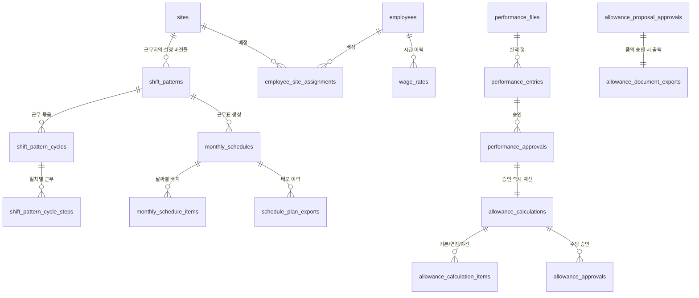

# 03. 데이터 모델 (표 36개)

> **기존 데이터를 100% 이어받는다**는 결정에 따라, 새 프로그램은 **이 구조를 그대로 열어야 한다.**
> 표 이름·컬럼 이름·타입을 바꾸면 운영 PC의 기존 DB를 못 읽는다.
>
> 원본: `src/main/services/sqlite-storage-service.ts` (스키마 정의 + 자동 컬럼 추가)

---

## 1. 데이터베이스 기본

```
엔진   : SQLite (Node 24 내장 node:sqlite — 별도 네이티브 모듈 없음)
모드   : WAL (journal_mode = WAL)
위치   : %APPDATA%\ShiftMgmt\data\shiftmgmt.sqlite          (설치본)
         %APPDATA%\shiftmgmt-v3-4\data\shiftmgmt.sqlite     (개발 실행본)
```

### 설계 특징 (그대로 유지)
- **모든 기본키는 TEXT** (UUID 문자열). 자동 증가 정수를 쓰지 않는다.
- **모든 날짜·시각은 TEXT** — 날짜 `YYYY-MM-DD`, 시각 `HH:mm`, 타임스탬프는 ISO 문자열.
- **불리언은 INTEGER 0/1**.
- **외래키(FOREIGN KEY) 제약이 걸려 있지 않다.** 관계는 코드가 지킨다. 기존 데이터의 정합성 정리가 선행돼야 해서 의도적으로 보류된 상태. 새 프로그램에서 갑자기 FK를 걸면 **기존 데이터가 로드되지 않을 수 있다** → 08 문서의 이관 계획 참조.
- 스키마 변경은 `CREATE TABLE IF NOT EXISTS` + `ensureColumn()`(있으면 건너뛰고 없으면 `ALTER TABLE ADD COLUMN`) 방식. **파괴적 마이그레이션이 없다.**

---

## 2. 영역별 표 지도



| 영역 | 표 |
|---|---|
| **인력·근무지** (4) | `sites`, `employees`, `employee_site_assignments`, `wage_rates` |
| **근무 패턴** (10) | `shift_patterns`, `shift_pattern_steps`, `shift_pattern_team_indexes`, `shift_pattern_cycles`, `shift_pattern_cycle_steps`, `shift_pattern_cycle_team_indexes`, `shift_pattern_team_cycles`, `shift_pattern_team_capacities`, `shift_pattern_team_settings`, `shift_pattern_duty_types` |
| **근무표** (3) | `monthly_schedules`, `monthly_schedule_items`, `schedule_plan_exports` |
| **공휴일** (2) | `holiday_calendars`, `holiday_items` |
| **요율** (3) | `allowance_rate_versions`, `allowance_rate_items`, `allowance_rate_history` |
| **사용자** (2) | `app_users`, `access_logs` |
| **양식** (2) | `document_template_versions`, `document_template_history` |
| **설정** (1) | `app_setting_entries` |
| **실적** (4) | `performance_files`, `performance_entries`, `performance_approvals`, `hidden_approved_performance_rows` |
| **수당** (5) | `allowance_calculations`, `allowance_calculation_items`, `allowance_approvals`, `allowance_proposal_approvals`, `allowance_document_exports` |

---

## 3. 표 상세

### 3.1 인력·근무지

#### `sites` — 근무지
| 컬럼 | 타입 | 비고 |
|---|---|---|
| id | TEXT PK | |
| site_code | TEXT NOT NULL **UNIQUE** | SITE-001 형식 자동 채번 |
| name | TEXT NOT NULL | |
| customer_name | TEXT | 고객사 |
| status | TEXT NOT NULL | `active` / `inactive` |
| timezone | TEXT NOT NULL | |
| deleted_at | TEXT | **소프트 삭제** — 값이 있으면 목록에서 숨김 |
| created_at / updated_at | TEXT | |

#### `employees` — 직원
| 컬럼 | 타입 | 비고 |
|---|---|---|
| id | TEXT PK | |
| employee_code | TEXT NOT NULL **UNIQUE** | 내부 식별용 코드. 비BP 인력은 실제 사번 필수. BP는 외부 사번이 없을 수 있으나 관계 보존용 내부 식별자는 유지 |
| name | TEXT NOT NULL | |
| contact | TEXT | |
| rank | TEXT | **사원/대리/과장/차장/부장만 유효** |
| employment_type | TEXT NOT NULL | 고용형태(BP 등 외부인력 포함) |
| status | TEXT NOT NULL | `active` / `leave` / `retired` |
| hire_date / retire_date | TEXT | |
| deleted_at | TEXT | 소프트 삭제 |
| created_at / updated_at | TEXT | |

#### `employee_site_assignments` — 근무지 배정 이력
| 컬럼 | 타입 | 비고 |
|---|---|---|
| id | TEXT PK | |
| employee_id / site_id | TEXT NOT NULL | |
| team_name | TEXT | |
| shift_group | TEXT | **조 이름 (A조 등)** |
| sort_order | INTEGER NOT NULL DEFAULT 0 | **조 안에서의 순서 — 배포 엑셀 줄 순서를 결정. 조장이 맨 위** |
| start_date | TEXT NOT NULL | |
| end_date | TEXT | |
| status | TEXT NOT NULL | `active` / `ended` |
| created_at | TEXT NOT NULL | |

#### `wage_rates` — 시급 이력
| 컬럼 | 타입 | 비고 |
|---|---|---|
| id | TEXT PK | |
| employee_id | TEXT NOT NULL | |
| hourly_rate | INTEGER NOT NULL | 원 |
| effective_from | TEXT NOT NULL | **적용 시작일 — 과거 날짜 소급 등록 가능** |
| effective_to | TEXT | 다음 시급 등록 시 자동으로 닫힘 |
| reason | TEXT | |
| created_at | TEXT NOT NULL | |

---

### 3.2 근무 패턴 (10개 표)

> 하나의 근무지에 **적용 시작일이 다른 패턴 레코드가 여러 개** 쌓인다(= 설정 버전). 각 패턴은 여러 **묶음(cycle)** 을 갖고, 조들이 묶음에 배정된다.

#### `shift_patterns` — 근무 설정(버전)
| 컬럼 | 타입 | 비고 |
|---|---|---|
| id | TEXT PK | |
| site_id | TEXT NOT NULL | |
| name | TEXT NOT NULL | |
| team_count | INTEGER NOT NULL DEFAULT 2 | 조 개수 (2~8) |
| cycle_length | INTEGER NOT NULL | |
| pattern_code / start_index_rule | TEXT NOT NULL | |
| pattern_start_date | TEXT | 패턴 회전 기준일 |
| **effective_from** | TEXT | **이 설정이 적용되는 시작일 (버전 키)** |
| pool_enabled | INTEGER NOT NULL DEFAULT 0 | 별도 근무 사용 여부 |
| pool_start_time / pool_end_time | TEXT | |
| pool_break_minutes | INTEGER NOT NULL DEFAULT 0 | |
| status | TEXT NOT NULL | `active` / `inactive` |
| created_at / updated_at | TEXT | |

#### `shift_pattern_cycles` — 근무 묶음
| 컬럼 | 타입 | 비고 |
|---|---|---|
| id | TEXT PK | |
| pattern_id | TEXT NOT NULL | |
| cycle_key | TEXT NOT NULL | 묶음 식별자 (예: `cycle-1`) |
| cycle_name | TEXT NOT NULL | |
| cycle_order | INTEGER NOT NULL | |
| shift_count | INTEGER NOT NULL DEFAULT 2 | 하루 교대 횟수 (1~3) |
| cycle_length | INTEGER NOT NULL | 주기 일수 |
| pattern_code | TEXT NOT NULL | |
| **pattern_string** | TEXT | **"주주야야휴휴" 형식의 패턴 문자열** |
| pattern_start_date | TEXT | 이 묶음의 회전 기준일 |
| **holiday_time_mode** | TEXT | `unified` / `split` (평·휴 분리) |
| **weekday_public_holiday_as_holiday** | INTEGER | 평일 공휴일을 휴일로 볼지 (기본 true) |
| created_at | TEXT NOT NULL | |

#### `shift_pattern_cycle_steps` — 묶음의 일차별 근무
| 컬럼 | 타입 | 비고 |
|---|---|---|
| id | TEXT PK | |
| cycle_id | TEXT NOT NULL | |
| step_index | INTEGER NOT NULL | 0부터 |
| duty_code | TEXT NOT NULL | |
| start_time / end_time | TEXT | 평일 시간 |
| break_minutes | INTEGER NOT NULL | 평일 휴게 |
| **holiday_start_time / holiday_end_time** | TEXT | **휴일 시간 (비면 평일 값으로 폴백)** |
| **holiday_break_minutes** | INTEGER | 휴일 휴게 |
| created_at | TEXT NOT NULL | |

#### `shift_pattern_cycle_team_indexes` — 묶음 안 조별 시작 위치
`id`, `cycle_id`, `team_label`, `team_index`, `created_at`

#### `shift_pattern_team_cycles` — 조 → 묶음 배정
`id`, `pattern_id`, `team_label`, `cycle_key`, `created_at`

#### `shift_pattern_team_settings` — 조별 설정
| 컬럼 | 비고 |
|---|---|
| team_label | 조 내부 식별자 |
| display_name | **표시 이름 (사용자가 바꿀 수 있음 — 내부 식별자와 다를 수 있으니 조회 키로 쓰면 안 됨)** |
| work_type | `ROTATING` / `FIXED_DAY` / `POOL` |
| is_active | 0이면 근무표 생성에서 제외 |
| sort_order | 표시 순서 |

#### `shift_pattern_team_capacities` — 조별 정원
`id`, `pattern_id`, `team_label`, `max_headcount`, `created_at`

#### `shift_pattern_duty_types` — 근무유형 카탈로그
| 컬럼 | 비고 |
|---|---|
| duty_type_id | **패턴 안에서의 유형 ID** — `(pattern_id, duty_type_id)` **UNIQUE 인덱스** |
| kind | `work`(시간 있음, 최대 3개) / `off`(무제한) |
| label | 주간·야간·휴무 등 |
| start_time / end_time / break_minutes | 평일 |
| is_break_dirty | 1이면 사용자가 손으로 고친 값 → 자동 재계산 안 함 |
| holiday_* | 휴일 시간 (같은 구조) |

#### `shift_pattern_steps` · `shift_pattern_team_indexes` (레거시)
묶음 개념 도입 이전의 평면 구조. **기존 데이터 호환용으로 계속 읽는다.** 묶음이 하나도 없으면 이 값들로 가상의 `cycle-1`을 만들어 동작한다(`getLegacyCycle`).

---

### 3.3 근무표

#### `monthly_schedules` — 달 단위 근무표
`id`, `site_id`, `schedule_month`(YYYY-MM), `pattern_id`, `generated_at`, `generated_by`, `template_version_id`

#### `monthly_schedule_items` — 날짜별 근무 배치
`id`, `schedule_id`, `employee_id`, `team_label`, `sort_order`, `work_date`, `duty_code`, `start_time`, `end_time`, `break_minutes`

> ⚠️ **이 표가 비면 실적 계산이 0분이 된다.** 과거 "법정공휴일 실적 0원" 사고의 진짜 원인이 여기였다.

#### `schedule_plan_exports` — 배포 이력
`id`, `schedule_id`, `schedule_month`, `site_name`, `pattern_name`, `template_version_id/label`, `output_file_name`, `output_path`, `update_count`, `publish_status`, `published_path`, `exported_at`

---

### 3.4 실적

#### `performance_files` — 들어온 엑셀 파일
| 컬럼 | 비고 |
|---|---|
| file_name / file_path | |
| directory_type | `pending` / `approved` / `unknown` |
| template_kind | `schedule-plan` / `attachment1` / `attachment2` / `proposal` / `unknown` |
| template_variant | 양식 변종 |
| sheet_name, row_count, column_count, file_size, modified_time_ms | 파일 지문 |
| **duplicate_key** | 중복 판정 키 |
| schedule_month, site_name, **schedule_key** | 어느 근무지·달의 근무표인지 |
| entry_count / approved_entry_count / warning_count | |
| **is_effective** | 이 파일이 현재 유효본인지 |
| status | `pending`/`parsed`/`approved`/`rejected`/`error` |
| preview_json | 원본 미리보기 (TEXT, JSON) |

#### `performance_entries` — 실적 행 (가장 컬럼이 많은 표, 40개)
핵심만:
| 컬럼 | 비고 |
|---|---|
| **logical_key** | **행의 논리적 신원** — 파일이 다시 들어와도 같은 행을 알아보는 키 |
| employee_code / employee_name / employee_rank | 지급 가능한 실적은 `employee_code`가 비어 있으면 안 됨. BP는 실적·수당 범위에서 제외 |
| work_date, work_hours | |
| **section** | `legal-holiday` / `substitute` / `overtime` |
| work_type | `regular`/`overtime`/`night`/`holiday`/`substitute` |
| duty_code, start_time, end_time, break_minutes | |
| total/base/overtime/night_work_minutes | **파싱 시점에 계산돼 저장** |
| hourly_rate | 적용 시급 |
| reason_text / evidence_text | 사유·증적 |
| source_signature / source_row_number / sort_order | 원본 추적 |
| alert_json | 경고 목록 (JSON) |
| **is_pool_worker** | Pool 표식 `홍길동(P)` |
| **substitute_work_type / target_work_type** | 대체 투입자·대상의 조 근무유형 |
| **substitute_allowance_eligible** | 대체수당 지급 여부 판정 결과 |
| **substitute_allowance_reason_code** | 판정 사유 코드 |
| **substitute_allowance_policy_version** | 판정 당시 정책 버전 |

> 마지막 5개는 **판정 결과를 행에 박아 두기 위한 것**이다. 나중에 정책이 바뀌어도 과거 행의 판정이 흔들리지 않는다. 다만 `DEC-001`에 따라 Pool·BP는 section과 무관하게 지급 대상에서 제외되고, 사번 없는 비BP 행은 새로 저장하지 않는다.

#### `performance_approvals` — 승인 기록
`id`, `file_id`, `entry_id`, `logical_key`, `file_name`, `schedule_key`, `employee_code/name`, `work_date`, `work_type`, `decision`(approved/rejected), `processed_at/by/by_name`, `comment`, `rejection_reason`, **`snapshot_json`**(승인 시점 스냅샷), `archived_file_name/path`

#### `hidden_approved_performance_rows` — 승인행 숨김
`approval_id`(**UNIQUE**), `logical_key`, `file_id`, `entry_id`, `hidden_at/by/by_name`

---

### 3.5 수당

#### `allowance_calculations` — 계산 결과 (핵심 표)
| 컬럼 | 비고 |
|---|---|
| performance_approval_id | 어느 승인건에서 나왔는지 |
| performance_entry_id | |
| calculation_version | 재계산 시 올라감 |
| status | `pending`/`approved`/`rejected`/`proposal-approved` |
| file_id/file_name, site_name, employee_code/name/rank | |
| work_date, work_type, hourly_rate | |
| rate_version_id / rate_version_label | **적용된 요율 버전** |
| total/base/overtime/night/holiday/substitute_minutes | 근무시간 분해 결과 |
| **total_allowance_amount** | INTEGER (원) |
| early_payout_date | 조기 지급일 |
| **signature** | TEXT **UNIQUE** — 중복 계산을 DB가 차단 |
| **snapshot_json** | 계산 전체 스냅샷 |

#### `allowance_calculation_items` — 라인 (기본/연장/야간)
`id`, `calculation_id`, `allowance_code`, `work_minutes`, `multiplier`, `amount`, `detail_json`

#### `allowance_approvals` — 수당 승인
`id`, `calculation_id`, `work_month`, `site_name`, `employee_code/name`, `work_date`, `work_type`, `decision`, `processed_at/by/by_name`, `comment`

#### `allowance_proposal_approvals` — 품의 승인 (월 단위 묶음)
| 컬럼 | 비고 |
|---|---|
| work_month | |
| calculation_ids_json | 포함된 계산건 ID 목록 |
| calculation_count / employee_count | |
| total_allowance_amount | |
| **regular_total_allowance_amount** / **early_payout_total_allowance_amount** | 정규분 / 조기지급분 |
| export_record_id | 출력된 문서 |
| output_format | `pdf` / `xlsx` |
| approved_at/by/by_name, comment | |
| **preview_snapshot_json** | 승인 시점 미리보기 전체 |
| **backup_summary_json** | 승인 시 만든 백업 정보 |

#### `allowance_document_exports` — 문서 출력 이력
`work_month`, `output_format`, `calculation_ids_json`, `calculation_count`, `employee_count`, `total_allowance_amount`, 3종 양식의 `*_template_version_id`, `proposal/attachment1/attachment2_file_name`·`_path`, `exported_at`

---

### 3.6 공통·설정

#### `holiday_calendars` / `holiday_items`
연도별 공휴일 달력과 항목(`holiday_date`, `name`, `is_substitute`). 공공 API로 가져오거나 손으로 추가·수정·삭제.

#### `allowance_rate_versions` / `allowance_rate_items` / `allowance_rate_history`
연도·적용기간별 요율 버전, 항목(`allowance_code` = `카테고리:축` 형식, `multiplier`, `rounding_policy`), 변경 이력(등록/수정/적용/삭제).

#### `app_users` — 사용자
`login_id`(**UNIQUE**), `display_name`, `role`, `status`, `password_hash`, `must_change_password`, `sign_in_failure_count`, `sign_in_locked_until`, `account_recovery_key_hash`, `account_recovery_key_issued_at`, `account_recovery_failure_count`, `account_recovery_locked_until`, `extension_number`, `contact`, `email`

#### `access_logs` — 활동 이력
`user_id`, `login_id`, `display_name`, `role`, `action_type`, `action_label`, `route_key`, `route_label`, `details`, `occurred_at`

#### `document_template_versions` / `document_template_history`
양식 파일 등록(근무표/품의서/별첨1/별첨2), `profile_json`에 셀 매핑·영역 정의가 들어간다. `is_default`, `status`(pending/approved), `checksum`.

#### `app_setting_entries` — 설정 (key-value)
주요 키:
```
databasePath, pendingDir, approvedDir
scheduleExportDir, allowanceProposalExportDir
allowanceAttachment1ExportDir, allowanceAttachment2ExportDir
databaseBackupDir, databaseBackupSchedule, databaseBackupTime
holidayApiBaseUrl, migrationFilePath
scheduleConsecutiveNightLimit, scheduleMinimumRestMinutes
scheduleRequireWeeklyHoliday, scheduleWeeklyMaxMinutes
substituteAllowancePolicyEffectiveFrom      ← 대체수당 신규 규칙 시작일
changedSlotPriorityEffectiveFrom            ← 변경후 우선 규칙 시작일 (운영 기본 2026-07-01)
```

---

## 4. 이어받기(마이그레이션) 규칙

### 4.1 반드시 지킬 것
1. **표·컬럼 이름을 바꾸지 않는다.** 이름을 바꾸면 기존 DB를 못 읽는다.
2. **컬럼을 지우지 않는다.** 쓰지 않는 컬럼도 남겨 둔다.
3. **새 컬럼은 `ensureColumn` 방식으로만 추가한다** (NULL 허용 또는 DEFAULT 필수).
4. **외래키 제약을 새로 걸지 않는다.** 기존 데이터에 고아 행이 있을 수 있어 로드가 실패한다.
5. **`signature` UNIQUE 제약을 유지한다.** 중복 계산 차단 장치다.
6. **사번 없는 과거 실적 정리는 V4 대상 데이터에서만 한다.** 원본 JSON과 복원 전 자동 백업은 보존하고, 승인·계산·숨김 이력이 연결된 행은 삭제하지 말고 전체 복원을 실패시킨다. 승인·계산이 없는 행만 같은 트랜잭션에서 제거하고 파일의 `entry_count`, `approved_entry_count`, `warning_count`, `preview_json`을 일관되게 맞춘다.

### 4.2 이관 절차 (요약, 상세는 08 문서)
```
1) 운영 PC에서 DB 파일 백업 (원본은 절대 건드리지 않음)
2) 백업본을 새 프로그램으로 열기 → migrateDatabase()가 자동 실행
3) 표 36개 행 수를 이전/이후로 대조 (기존 "데이터베이스 상태 스냅샷" 기능 재사용)
4) 허가된 변환(`app_setting_entries` 현재 환경 유지, `DEC-001` 무사번 미승인 실적 제거)은 행 ID·전후 건수·경고를 별도 대조
5) 승인된 수당 총액을 이전/이후로 대조 → 1원도 달라지면 안 됨
6) 대시보드 월별 집계를 이전/이후로 대조
```

### 4.3 이미 있는 도구 (그대로 재사용)
| 기능 | 서비스 |
|---|---|
| 상태 스냅샷(표별 행 수) | `database-migration-service.ts` (`DatabaseMigrationStateSnapshot`) |
| 백업 | `database-backup-service.ts` |
| 교체·복원 | `database-replacement-service.ts` |
| Access(구 시스템) 가져오기 | `database-migration-service.ts` (103KB) |
| 시작 시 자동 복구 | `performance-startup-recovery-service.ts` |

> 운영 관리 화면에 이미 **"현재 상태 vs 미리보기 상태"를 표로 비교하는 화면**이 있다. 이관 검증에 그대로 쓸 수 있다.
