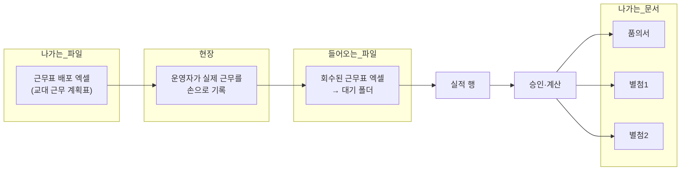

# 06. 엑셀 입출력 명세

> 이 프로그램의 입력과 출력은 대부분 **엑셀 파일**이다. 규칙이 가장 복잡하고 사고가 가장 많이 났던 영역이다.
> 회수본 **파싱 규칙은 보존**한다. 출력 쪽은 R-15에 따라 등록 양식 파일을 읽는 방식을 없애고, 프로그램 내 기본 레이아웃 + 저장된 레이아웃 정의로 생성하도록 Phase 2.5에서 교체한다.
>
> 라이브러리: `exceljs` 4.4 (읽기·쓰기 모두)

---

## 1. 전체 그림



### 폴더 (운영 PC 기준)
```
C:\연장근무실적\
   ├─ 대기          ← 회수한 엑셀을 여기 넣으면 자동 인식
   ├─ 승인          ← 승인 완료된 파일 보관
   ├─ 배포관리      ← 근무표 배포 엑셀 출력
   ├─ 품의서
   ├─ 별첨1
   └─ 별첨2
```
경로는 전부 운영 관리 화면에서 바꿀 수 있다(`app_setting_entries`).

---

## 2. 들어오는 엑셀

### 2.1 폴더 감시 → 인테이크
- `chokidar`로 대기·승인 폴더를 감시한다. 파일 추가/변경/삭제 이벤트를 받는다.
- 새 파일을 발견하면 **자동으로 읽어 해석**한다. 사용자가 버튼을 누를 필요가 없다.
- 파일 지문(`file_size`, `modified_time_ms`, `duplicate_key`)으로 **중복·재유입을 판정**한다.
- 서비스: `file-watch-service.ts`, `file-watch-runtime-service.ts`, `performance-file-intake-service.ts`

### 2.2 양식 종류 판정
**첫 시트 이름**으로 판정한다.
| 시트 이름 | 종류 |
|---|---|
| `교대 근무 계획표` | `schedule-plan` (근무표 회수본) |
| `별첨1` | `attachment1` |
| `별첨2` | `attachment2` |
| `품의서` | `proposal` |
| 그 외 | `unknown` |

### 2.3 근무표 회수본 해석 (가장 복잡 — 67KB)
`schedule-return-performance-parser.ts`

**구조**: 왼쪽에 본표(그리드, 날짜×조), 오른쪽에 대체표(대체근무 내역)가 붙어 있다.

#### 핵심 규칙
| 규칙 | 내용 |
|---|---|
| **휴일 판정** | 본표 날짜칸의 **셀 배경색(분홍 `FFFFD1D1`)** 으로 판정한다. **색칠이 없으면 휴일 행이 생기지 않는다** |
| **분홍칠 ≠ 공휴일 달력** | 파서의 분홍칠과 계산의 공휴일 달력은 **독립된 두 스위치**다. 달력에 없는 날도 분홍칠이면 법정공휴일로 잡힌다 |
| **변경전/변경후** | 근무자가 바뀐 칸. 적용 시작일 이후 근무일은 **변경후 우선**(→ 02 문서 6장) |
| **대체근무 이중계산 차단** | 대체표 행이 가리키는 **그 그리드 슬롯 하나만** 취소한다. 같은 이름이 여러 슬롯에 있어도 한 행은 한 슬롯만 취소 |
| **슬롯 선택 우선순위** | ① 변경후 칸이 대체자와 일치하는 슬롯 → ② 원근무자 이름이 일치하는 첫 슬롯 → ③ 없으면 취소하지 않음 |
| **조 근무유형 조회** | 그 근무표가 쓴 패턴의 조별 설정에서 읽는다. 패턴을 못 찾으면 이름 기준 기본값으로 떨어져 **예전 동작(Pool 이름만 Pool 취급)** 과 같아진다 |
| **추가근무 판정** | 대체 투입자가 그 근무를 원래 자기 정규근무로 하고 있었으면 추가근무가 아니다. **근무코드가 같을 때만** 정규근무로 본다 |
| **Pool 표식** | 이름이 `홍길동(P)` 형태면 Pool 근무자 |
| **파일명 중복 접미사** | `(1)`, `- 복사본` 등을 제거해 근무지명을 정규화한다 |

#### 해석 결과
행마다 **구분(section)** 이 정해진다: `legal-holiday` / `substitute` / `overtime`
그리고 근무시간이 그 자리에서 계산돼 저장된다(총/기본/연장/야간).

#### 대체수당 판정도 이 시점에 수행
투입자·대상의 조 근무유형을 읽어 지급 여부와 사유 코드를 **행에 박아 둔다**. 나중에 정책이 바뀌어도 과거 행이 흔들리지 않는다.

### 2.4 그 밖의 입력
| 입력 | 용도 | 서비스 |
|---|---|---|
| 시급 일괄 엑셀 | 근무지명·이름·시급 열을 매핑해 일괄 등록 | `workforce-wage-bulk-update-service.ts` |
| 기존 근무표 엑셀 | **근무 패턴 역추출** — 조 구성·주기·시작위치 자동 감지 | `site-pattern-extraction-service.ts`, `site-pattern-detection.ts` |
| 별첨1 엑셀 | 과거 데이터 가져오기 | `excel-template-parser.ts` |

### 2.5 데이터베이스 백업·복원 입력

운영 화면의 데이터베이스 복원 입력은 **JSON 백업 1개만** 허용한다. `.accdb`와 `.xlsx`는 선택·검사·복원 대상이 아니다. 회수 근무표·시급 일괄·패턴 역추출에 쓰는 Excel 입력은 업무 입력이므로 이 규칙의 대상이 아니다.

---

## 3. 나가는 문서

### 3.1 기본 레이아웃 + 캔버스 + 생성기 체계

양식 파일을 등록하지 않는다. 문서 종류마다 프로그램 안에 **기본 레이아웃**이 있고, 운영 관리의 캔버스가 기본 레이아웃 또는 저장된 레이아웃 정의를 편집한다. 생성기는 저장된 정의가 있으면 그것을, 없으면 기본 레이아웃을 사용해 Excel·PDF를 만든다.

```
document_template_versions
   ├─ template_type : 저장 키(근무표는 schedule-xlsx/template1 또는 /template2)
   ├─ source_path   : 항상 빈 문자열 (파일 의존 없음)
   ├─ profile_json  : 레이아웃 정의 JSON
   ├─ version_label : 불변 판 식별자
   ├─ status        : 내부 저장값 approved 고정
   ├─ is_default    : 문서 종류·변형별 활성 판 1개 표시
   └─ created_at    : 저장 이력
```

`profile_json`은 최소한 다음을 가진다.

- **상위 필드** — 스키마 판, 생성기 호환 판, 문서 종류, 선택적 변형(`template1`/`template2`), 물리 출력 배열 `outputs[]`
- **outputs[] 멤버** — `memberId`, 독립 캔버스, 출력 파일명 규칙, 그 파일에 속한 `blocks`
- **blocks** — 제목/머리글/필드/요약/표/서명란/주차/비고/로고/바닥글의 위치·크기·표시 여부와 열 너비·글꼴·데이터 바인딩

`proposal-pdf`의 `outputs[]`는 순서대로 `proposal`, `attachment1`, `attachment2` 세 멤버를 가지며 각자 A4 방향·여백·파일명·블록을 저장한다. 나머지 저장 키는 `memberId="main"`인 멤버 하나만 가진다. 편집 가능 속성과 해석기 보호 구조인 `capabilities`는 사용자가 저장하는 정의가 아니라 프로그램이 레이아웃 조회·미리보기 응답에 함께 계산해 제공한다.

사용자가 바꿀 수 있는 것은 **위치·크기·표시 여부·문구·로고·열 너비·글꼴**이다. **줄 순서, 계산값, 필드 내용·바인딩, 행 높이, 병합 범위, 근무표 회수 판독에 쓰이는 표 구조**는 바꿀 수 없다. 2.5-1 v1.0은 행 높이·병합 편집 예외를 두지 않는다. 캔버스 미리보기는 별도 그림이 아니라 저장 전 초안을 **실제 생성기**에 넣은 결과다.

저장 키는 `schedule-xlsx/template1`, `schedule-xlsx/template2`, `proposal-xlsx`, `attachment1-xlsx`, `attachment2-xlsx`, `proposal-pdf`, `dashboard-report-pdf`다. `profile_json` 상위의 `documentKind`·`variant`는 저장 키와 일치해야 한다.

저장 성공 판은 즉시 활성화되고 과거 판은 이력으로 남는다. 저장·되돌리기는 트랜잭션에서 새 행을 `status='approved'`, `is_default=1`로 저장하고 같은 저장 키의 이전 행을 `is_default=0`으로 바꾼다. 활성 표시가 2개 이상이면 데이터 오류이며, 저장 행이 없으면 프로그램 내 기본 레이아웃을 쓴다. 이 값은 내부 저장·조회용이며 사용자가 승인하거나 기본 파일을 고르는 흐름은 없다. 삭제도 없다. 기존 파일 기반 종류(`schedule`/`proposal`/`attachment1`/`attachment2`) 또는 비어 있지 않은 `source_path`의 행은 역사 데이터로만 보존하고 생성기에서 제외한다. **기본 레이아웃으로 되돌리기**는 내장 정의를 복사해 새 활성 판을 만드는 동작이며 이력을 지우지 않는다.

생성기는 실행 시 AI·인터넷·외부 API에 연결하지 않는다. 개발용 레이아웃 명세 문서와 샘플은 생성기의 런타임 의존성이 아니다.

**출력 용지 기준(2026-11-06 사용자 확정): 모든 문서는 A4만 사용한다.** 근무표 Excel은 근무표·변경 내역·대체/연장 현황을 구역별로 나눠 인쇄하고, 품의서·별첨 Excel은 표의 가로를 한 페이지에 맞추되 내용이 많으면 세로로 이어진다. 인쇄 영역에는 실제 값과 표시되는 문구·그림을 포함하며 인쇄 설정 때문에 데이터·행순서·병합·회수 판독 구조를 바꾸지 않는다. PDF도 A4만 사용하고 문서별 세로/가로 방향을 유지한다.

### 3.2 근무표 배포 엑셀
- 시트 이름 `교대 근무 계획표`
- 날짜×인원 그리드. 근무 코드는 `D`/`E`/`N`/`O`
- **줄 순서 = 조 → 배정 순서 → 사번.** 이름순 재정렬 금지
- 기본 레이아웃 변형은 `template1`·`template2` 두 가지지만 논리 출력 종류는 하나다.
- 배포 파일에 레이아웃 판 식별자를 넣고, 회수 해석기는 그 판의 보호 구조를 사용한다. 고정 11행·34행 의존은 2.5-4에서 제거한다.
- 서비스: `schedule-plan-preview-service.ts`, `-export-`, `-publish-`, `-template-`

### 3.3 품의서 · 별첨1 · 별첨2 · PDF
품의 승인 시 품의서·별첨1·별첨2 Excel과 품의서 PDF를 생성한다. 대시보드에서는 보고서 PDF를 생성한다. (`allowance-document-export-service.ts` 118KB, 현행 PDF 서비스는 `allowance-document-pdf-service.ts` 68KB)

| 문서 | 내용 |
|---|---|
| **품의서** | 결재용 표지. 월 총액, 근무지별 요약(대체/연장/휴일), 정규분·조기지급분 분리 |
| **별첨1** | 근무 건별 상세. 사번·이름·**직급**·근무지·근무일·구분·시간·배율·시급·금액 |
| **별첨2** | 근무지별 지급 요약. 계산 결과 한 건마다 이름·대체/연장/휴일 금액을 한 행으로 쓰며, 근무지 소계·전체 합계를 둔다 |
| **품의서 PDF 묶음** | 논리 레이아웃 키는 `proposal-pdf` 하나지만 현행 동작을 보존해 품의서·별첨1·별첨2 PDF 3파일을 함께 출력한다. 품의서는 합계·근무지 요약·차트, 별첨은 Excel과 같은 원천 데이터를 각 PDF 표로 표현한다 |
| **대시보드 보고서 PDF** | 선택한 조회 범위의 차트·요약을 PDF 레이아웃으로 출력 |

#### 알려진 함정
- **직급이 "-"로 나오는 문제**: 인력에 직급이 안 들어 있거나 5개 값이 아니면 버려진다.
- **병합 셀 깨짐**: 행을 삽입(`spliceRows`)하면 병합 정보가 어긋난다 → **삽입 후 병합 레지스트리를 재구축**하는 처리가 들어 있다. 이 처리를 빠뜨리면 양식이 깨진다.
- **구형 양식 호환**: 옛 품의서는 셀 위치가 1칸 밀려 있어 오프셋 보정이 들어 있다.

---

## 4. 실물 샘플의 지위 — 개발 대조·해석기 시험 전용

`양식샘플/` 폴더:
```
근무표_템플릿1.xlsx / 근무표_템플릿2.xlsx     ← 배포 양식 2종
근무표_샘플1.xlsx / 근무표_샘플2.xlsx          ← 회수본 샘플 (파싱 시험용)
품의서_2026-04_수정본.xlsx
별첨1_샘플.xlsx / 별첨1_2026-04_수정본.xlsx
별첨2_샘플.xlsx
DT사업1팀_교대근무관리DB.accdb                 ← 역사 대조 표본(런타임 복원 금지)
```

- `근무표_템플릿1/2.xlsx`, 품의서, 별첨1, 별첨2는 **2.5-1 기본 레이아웃 추출**과 **2.5-2 값·병합·서식 셀 단위 대조 테스트**에만 쓴다.
- `근무표_샘플1/2.xlsx`는 회수본 해석기 회귀 시험에 쓴다.
- `.accdb`는 역사 대조 표본일 뿐 제품의 백업·복원 입력이 아니다.
- 이 파일들을 `extraResources/templates/defaults`로 설치 패키지에 넣거나 운영 중 읽지 않는다. 테스트 픽스처로 포함할지는 2.5-1의 재현성·저작권 검토 뒤 결정한다.
- 기본 레이아웃은 코드/JSON 자산으로 프로그램에 포함되며, 샘플이 없어도 6종 출력이 생성되어야 한다.

### 4.1 논리 출력 6종

| # | 종류 | 기본 변형 |
|---|---|---|
| 1 | 근무표 배포 Excel | `template1`, `template2` |
| 2 | 품의서 Excel | 1 |
| 3 | 별첨1 Excel | 1 |
| 4 | 별첨2 Excel | 1 |
| 5 | 품의서 PDF | 1 |
| 6 | 대시보드 보고서 PDF | 1 |

6종의 정확한 좌표·병합·서식·블록 보호 범위는 2.5-1 명세에서 확정한다.

---

## 5. 검증 자산

엑셀 해석은 과거에 **규칙 47개를 전수 검증**하고 **33개 시나리오 실험**을 거쳤다. 그 시험들이 테스트로 남아 있다.

| 테스트 | 검증 내용 |
|---|---|
| `excel-import-gap-campaign.test.ts` | 규칙 누락 케이스 |
| `excel-import-stress-campaign.test.ts` | 변형·오류 입력 |
| `changed-slot-priority-rule.test.ts` | 변경후 우선 규칙 |
| `holiday-substitute-*.test.ts` (여러 개) | 휴일 대체근무 이중계산 |
| `holiday-none-regular-credit.test.ts` | 변경전 None 처리 |
| `boramae-holiday-*.test.ts` | 실제 사고 재현 |
| `performance-file-intake-service.test.ts` | 인테이크 전체 |

**이관 후 이 테스트들이 전부 통과해야 엑셀 처리가 제대로 옮겨진 것이다.**

Phase 2.5에서는 여기에 기본 레이아웃 6종 대조, 조정 레이아웃 배포→회수→해석 왕복, 레이아웃 판 불일치·보호 구조 변조 거부, JSON 40표 스키마/일반 표 39개 복원 시험을 추가한다.

---

## 6. 새 화면이 지켜야 할 것

1. **실적을 화면에서 직접 입력하는 기능을 만들지 않는다.** 엑셀 인테이크가 유일한 경로다.
2. 인테이크는 자동이지만 **진행 상태와 실패 사유를 화면에 보여줘야** 한다(파일이 안 뜬다는 신고가 가장 많았다).
3. 해석 결과의 **경고(alert)를 행마다 표시**한다. 조용히 넘어가면 운영자가 잘못된 승인을 한다.
4. 문서 출력 후 **저장 경로를 보여주고 폴더 열기**를 제공한다.
5. 양식 파일 등록·선택·승인·기본 파일 지정 UI를 만들지 않는다.
6. 캔버스의 잠긴 블록은 편집을 거부하고 그 이유를 표시한다.
7. 데이터베이스 백업·복원 선택지는 JSON만 제공한다. Excel·Access 선택지를 남기지 않는다.
