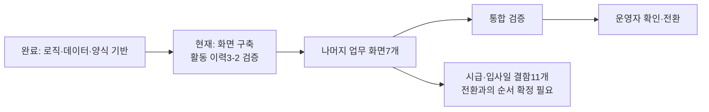

# 전체 위치·잔여 시간·필수성 조사 — 2026-10-26

조사 기준: 현재 HANDOFF(U6-b), TODO, 원래 화면 검증 계약, 재구축 계획, 실제 V4 화면 코드와 실행 receipt. 이 문서는 **현황과 1차 견적·개선 제안**이며 구현·수용·배포 승인이나 기존 확정 계획의 변경이 아니다.

## 1. 전체 프로젝트에서 현재 위치

**업무 로직·데이터·문서 생성 기반을 마쳤고, 업무 화면 재구축 단계의 활동 이력 검증을 진행 중이다. 전체 프로젝트의 마무리 단계는 아니다.**

| 범위 | 확인한 현재 상태 |
|---|---|
| Phase0 준비·시안 | 34파일 사용자 검수 완료. MINOR13건 미검토분은 별도 분류 필요. |
| Phase1 로직·실행 기반 | 완료 기록. 로컬 서버·Chrome·통신·이식 로직 기반이 있다. |
| Phase2 데이터 이어받기 | 완료 기록. 원본/복원 데이터와 승인 금액을 대조했다. |
| Phase2.5 양식·엑셀·PDF·JSON 기반 | 완료 기록. 화면에서 연결할 생성·저장·복원 기반이 있다. |
| Phase3 로그인·셸·홈 | 구현·통합 검수 완료 기록. 사용자 직접 화면 확인은 남아 있다. |
| Phase3 활동 이력(3-2) | 정상 시나리오53/81 수용. U6-b 설계 완료, U6 구현 지시 미발행. |
| Phase3 나머지 업무 화면7개 | 계획 대기. 실제 shell도 활동 이력 이외 업무 메뉴에 ‘화면 준비 중’ 안내를 표시한다. |
| Phase4 통합 검증 | 미착수. 전체 업무 흐름과 기존 결과를 대조해야 한다. |
| Phase5 운영 전환 | 미착수. 병행 대조·운영자 확인·최종 이관·설치/패치가 남았다. |
| Phase6 시급·입사일 결함11개 | 미착수. Phase1~3 완료 및 기존 시험 보증 뒤 착수하는 조건이다. Phase5 이후라고 확정한 것은 아니다. |

**53/81=약65.4%는 활동 이력의 정상 시나리오 검증 비율이다. 전체 프로젝트 완료율이 아니다.** 남은28개는 오래된 응답12, 역할 권한9, 세션 만료7이다. 원81개에 셸·홈 회귀6개를 더한 별도 전체87개 검증과, 검증기 원124개 의무 대조는 서로 다른 집합이다. 단순 합산하면 중복 집계가 된다.

원래 계획은 화면 재구축이 전체 작업의70~80%라는 ‘규모 감각’을 적었다. 실측 가중치가 아니므로 이 수치를 현재 완료율로 계산하지 않았다. 현재 객관적으로 말할 수 있는 위치는 **기반 완료 → 업무 화면 구축 초반**이다.

근거: [TODO 진행 요약·Phase3~6](TODO.md), [원 재구축 계획 §2·§6](08-rebuild-plan.md), [실제 업무 메뉴 분기](../ShiftMgmt_V4/src/web/screens/shell.ts:267), [현재 HANDOFF](HANDOFF.md).

## 2. 시간 견적의 기준과 한계

- 아래는 **순차적으로 설계·구현·검수하는 순작업 시간의 예산**이다. 달력상 완료일이나 보장 시간이 아니다.
- 기존 backend/이관 로직/양식 생성기를 재사용하고 승인 시안·기능 범위를 유지하는 가정이다. 각 단위에는 설계·구현·관련 검증·완료 정리를 포함한다.
- Gemini 수동 중계 대기, 사용자 화면 확인·정책 답변, 모델 한도/장애, 운영 데이터 제공 대기는 제외한다. 이 대기는 순작업 시간과 별도로 달력 일정에 더해진다.
- 표는 기본 범위이며 전체 합계에 **불확실성 여유25%를 한 번** 더했다. 각 행에 다시 중복 가산하지 않았다. 알려지지 않은 중대 결함이나 새 기능은 별도다.
- **새 업무 화면7개의 실제 생산 속도가 아직 없으므로 전체 견적 신뢰도는 낮다.** 인력 관리 첫 화면을 마친 뒤 실제 설계/구현/검수 시간으로 재산정해야 한다.
- 준비 단계에 안내했던15~25분은 그 단계의 추정이었으며, U6 구현·검수나 전체 제품 잔여 시간을 뜻하지 않는다. 이번에는 총량과 단위 시간을 분리했다.

## 3. 바로 앞에 남은 활동 이력 작업

| 작업 단위 | 추정 순작업 시간 | 시간이 필요한 이유 | 필수성 |
|---|---:|---|---|
| U6-c 검증 도구 준비 | 3~6시간 | 새 자료 형식 판독, source/소유권/시계·콜백 증거, 기존 검문 재사용, 거절 조건·실행 계획 준비 | 검증 준비는 필요. 구체 도구 구성은 단순화 검토 가능 |
| U6 Gemini 구현 | 2~4시간 | 현재 정상 화면에 관측·판독·발행 경로 연결. 설계는 기존9+신규5개 파일 범위 | 현재 승인한 검증 연결 범위에서 필요 |
| U6 실제 통합 검수 | 1~2시간 | 새 코드에서 원12개, 실제 콜백, 오류·정리·기존53개와의 호환 확인 | 필요. 반드시 구현 후 실행 |
| U7 역할 권한 원9개 | 3~6시간 | 비관리자 화면·자동 요청 차단과 직접 API 거절 확인 | 권한 안전상 필요 |
| U8 세션 만료 원7개 | 3~6시간 | 세션 만료 시 화면·요청·콜백이 정확히 정리되는지 확인 | 세션 안전상 필요 |
| 전체A2/B 대조·회귀·종결 | 4~8시간 | 원124 의무의 충족 근거와 전체87 검증을 대조하고 커밋/사용자 확인 준비 | 현재 정식 수용 기준상 필요 |
| **활동 이력 잔여 합계** | **16~32시간** | 위6개 단위의 합계. 아래 전체 표의 활동 이력 행과 같은 값 | 중복 합산하지 않음 |

U6만 보면 첫3개 단위의 합계인 **6~12시간**이 1차 추정이다. 아직 구현되지 않은 작업의 견적이며 실제 처리량으로 검증된 숫자가 아니다. 결함 재발·추가 회귀는 전체 여유 시간에서 다루되, 규모가 크면 재견적한다.

### 구현 전후의 순서 혼선

현재 HANDOFF의 다음 단계3은 ‘새 정본의 실제 producer/reader·errors8 해시 교체·기존53개 검증’을 요구하고, 단계5는 대표 실제 경로 통과 뒤 IMPLEMENT를 발행하도록 읽힌다. 반면 설계 정본의 verification-plan은 실제 제품 통합·회귀를 **구현 후**로 적었다. 새 모듈이 없고 Sol의 제품 수정 권한도 없는 상태에서 구현 의존 검증을 전부 구현 전 조건으로 두면 준비가 순환한다.

올바르게 구분할 제안은 다음과 같다.

1. **구현 전:** 검증 도구 자체 검사, 거절 fixture 준비, 기존 소스의 실측·실현 가능성 확인.
2. **Gemini 구현:** 허용 범위에서 실제 제품 경로를 연결.
3. **구현 후:** 새 제품의 실제 통합, 변경된 해시 결합, 기존53개 회귀, 최종 전체 검증.

이는 필수 검증을 없애자는 제안이 아니다. **구현 뒤에야 가능한 검증을 앞 단계의 착수 조건과 구분하자는 것**이다. 이번 조사는 순서 혼선을 확인했으며, 현재 HANDOFF나 봉인 계약을 자동으로 수정하지 않았다.

근거: [HANDOFF 다음 작업](HANDOFF.md), [verification-plan](.ai/contracts/phase3-2c-a2-u6-design-r1/verification-plan.json), [제품 작성 권한](AGENTS.md).

## 4. 전체 잔여 범위와 추정

| 작업 단위 | 추정 순작업 시간 | 주요 이유 | 꼭 해야 하는가 |
|---|---:|---|---|
| 활동 이력 잔여 | 16~32시간 | 위 U6~U8, 전체 검증 연결·종결 | 현재 완료 기준상 필요 |
| 인력 관리 | 16~24시간 | 목록·상세·변경 이력·입사일/시급 안내를 실제 API에 연결 | 핵심 업무·승인 범위 |
| 운영 관리 | 32~56시간 | 탭7개, 캔버스 편집·미리보기·저장, JSON 복원. O6/O7 시안 보완 필요 | 승인 범위에서는 필요. 편집 고급 기능 분할은 범위 결정 사항 |
| 근무지 관리 | 40~72시간 | 2단계 마법사·페인팅·시뮬레이션·상태 일관성 | 핵심 업무. 난도 높음 |
| 근무표 배포 | 16~24시간 | 조건/대상 선택, 실제 생성·배포·파일 경로 연결 | 핵심 업무 |
| 실적 관리 | 40~72시간 | 대량 데이터,8종 상태, 인테이크·승인·재승인·금액 연결 | 핵심 업무·금액 안전. 난도 높음 |
| 수당 관리 | 24~40시간 | 승인 상태, 품의 미리보기, 문서3종 출력 연결 | 핵심 업무·금액/문서 일치 |
| 대시보드 | 16~24시간 | 실제 집계·차트, 라이브러리 결정, CSP 검증 | 승인 범위에서는 필요. 핵심 승인/계산 흐름과는 구분 가능 |
| 전체 통합 검증 | 16~32시간 | 실제 자료로 전체 업무 흐름, 기존/신규 금액·행수·파일 대조 | 운영 안전상 필수 |
| 전환 준비·적용 실작업 | 8~16시간 | 병행 대조, 최종 백업·이관·패키지/적용·health 확인 | 실제 전환 시 필수. 사용자 대기는 별도 |
| 시급·입사일 결함11개 | 24~48시간 | 이력 보존·대상 찾기·시급 시점·재승인/재입사 정합 | 승인한 수정 범위. 규칙 위반2건은 특히 중요 |
| 미검토·판단 항목 분류 | 2~4시간 | MINOR13건·남은 결정의 영향과 시점 구분 | 분류 시간만 포함. 미확인 결함 수정은 추가 가능 |
| **기본 합계** | **250~444시간** | 편의상 약250~450시간 | 순작업 예산 |
| **여유25% 포함** | **약310~560시간** | 계산값312.5~555시간을 둥글게 표시 | 대기 시간·신규 범위는 별도 |

1일8시간, 주5일 **실제 작업이 진행되는 가정**으로 환산하면 약8~14작업주다. 현재 납기로 확정할 수 없고, 사용자/Gemini 중계·정책 결정·운영자 확인 대기를 넣으면 달력 기간은 늘어난다. 첫 업무 화면의 실측 전에 좁은 날짜를 약속할 근거는 없다.

병행 운영 계획은 **‘한 달치 자료를 양쪽에서 처리해 대조’**다. 문서만으로는 새로 한 달을 반드시 기다려야 한다고 단정할 수 없다. 과거 한 달 자료를 사용할지 실제 병행 기간을 둘지는 전환 계획에서 정해야 한다.

Phase6은 숫자가6이라고 반드시 배포 뒤라는 뜻이 아니다. 문서상 착수 조건은 Phase1~3 완료와 회귀 보증이며 Phase4~6의 우선순위는 명확히 확정되지 않았다. 금액 대상 누락·시급 이력 덮어쓰기2건은 본격 운영 전에 처리하는 방향을 권고하지만, 실제 반영·전환 순서는 별도 확정이 필요하다.

## 5. Phase6의11개 수정은 어떤 묶음인가

| 묶음 | 세부 항목 | 추정 | 이유·필수성 |
|---|---|---:|---|
| 규칙 위반2건 | 사번으로 일괄 시급 대상 찾기/퇴사자 우선 제외, 같은 적용일 재저장 시 이전 금액·사유 보존 | 6~12시간 | 조용한 누락과 이력 소실을 막는 필수 수정 범위 |
| 표시·입사일2건 | 오늘 기준 현재 시급/적용일 표시, 입사일 수정 경로 | 4~8시간 | 화면 표시와 업무 의미 일치 |
| 재계산·재승인4건 | 승인 동등성, 시급 변경 후 대기 실적 재읽기, 승인대기 복귀 시 시급 적용, 이력 정정/무효 처리 | 8~16시간 | 승인 결과와 수정 이력이 뒤섞이지 않도록 검증 필요 |
| 잔여3건 | 퇴사 시 시급·배정 종료, 같은 사번 재입사, 이관 입사일 대체 규칙 | 6~12시간 | 정책 결정이 포함되며 답변 대기는 별도 |

이24~48시간은 전체 표의 Phase6 행과 같은 값이다. 별도 추가 합계가 아니다. 실제 돈/기록을 바꾸는 구현에서는 기존 승인 결과를 덮지 않는 규칙, DB/마이그레이션 경계와 관련 회귀 검증을 유지해야 한다.

근거: [시급·입사일 계획 §4-5·§6](13-시급-입사일-결함-반영계획.md), [제품 불변조건](07-invariants-and-pitfalls.md).

## 6. 왜 시간이 걸리는가 — 실측과 추정의 구분

| 실제 명령 | 측정한 시간 | 결과 | 해석 |
|---|---:|---|---|
| U3 full88 | 29분24초 | RC0 | 전체 묶음 명령1회의 실행 시간 |
| U4 full88 | 31분01초 | RC0 | 전체 묶음 명령1회의 실행 시간 |
| U5 마지막 full39 시작 | 47분37초 | RC1 | 내부 실제92개를88로 비교한 집계 실패를 포함. 전체 성공 시간으로 세지 않음 |
| U6 새 callback 집중 실행 | 약66초 | RC0 | 빌드·준비·18상황·정리를 포함한 명령 시간 |

U5는 전체 검증을11번 시작했고 해당 명령 시간의 합이107.26분이었다. 이것은 전체 개발 시간이나 전부 피할 수 있었던 낭비 시간이 아니다. **명령 실행 시간을 전체 작업 시간으로 추정하지 않았다.**

현재 U6에서 주로 만드는 것은 화면 기능보다 관측·판독·발행의 검증 연결이다. 시간이 늘어나는 이유는 다음과 같다.

- 실제 화면 동작과 자동 수용 기록을 연결하는 코드·거절 검문 작성.
- 복잡한 기존 검증기와 해시/자료 형식/실행 분기 결합을 유지하는 비용.
- 같은 기능을 여러 검증 층에서 다시 설명·구현하고, 검증기 자체 결함을 처리하는 비용.
- 수동 중계·반려/재시도·최종 검수의 순차 의존성.

이 중 마지막 준비 순서 혼선과 중복 도구 구성은 제품 기능이 요구하는 본질적인 비용과 구분해야 한다. 장시간이 걸렸다는 사실만으로 그 작업 전부가 반드시 필요했다고 결론 내릴 수 없다.

실측 원문: [U3](.ai/reports/phase3-2c-a2-u3-poll-20261024_115308/poll-full88.command.json), [U4](.ai/reports/phase3-2c-a2-u4-retry-audit-20261024_225826/sol12-full88.command.json), [U5](.ai/reports/phase3-2c-a2-u5-sol-takeover-20261025_175721/sol-full39-v11.command.json), [U6](.ai/reports/phase3-2c-a2-u6-design-20261026_030100/canonical-callback-native.command.json).

## 7. 반드시 필요한 것과 조정 가능한 것

| 구분 | 판단 |
|---|---|
| 데이터/금액/이력 보존, 권한·세션 안전, 실제 기능 연결 | 운영 안전의 필수 요건 |
| 승인한8개 업무 화면과 시급·입사일 수정 범위 | 현재 승인 범위에서는 완료 대상. 일부를 나중에 하려면 범위를 명시적으로 나눠야 함 |
| 원81/87 및 검증기124의 충족 근거 | 현재 수용 기준상 필요. 중복 집계하거나 요건을 임의 생략하면 안 됨 |
| 실제 앱 캡처·클릭, 필요한 음성/회귀, 백업·최종 이관 확인 | 필수. 실제 운영 PC 적용에는 해당 턴의 명시 승인 필요 |
| 이중 Node/Python 판독, 판정마다 독립 재빌드, 커지는 해시 연결, 정확히52개라는 새 검문 묶음 | 원 제품 요구사항이 지정한 유일한 구현 방식은 아님. 지금 설계에 들어 있으므로 임의 생략할 수는 없지만, 같은 증거·거절 수준을 지키는 후속 설계로 단순화 가능 |
| 의미가 겹치는 검문을 별도 명령/fixture로 중복 작성 | 통합·재사용 가능. 거절해야 할 동작 자체를 없애자는 뜻은 아님 |
| 일반 리팩터링·새 외래키·안내문 대폭 정리 | 별도 개선/판단 항목. 당장 전체를 끝내는 필수 작업으로 묶지 않음 |
| MINOR13건 | 아직 미검토분이므로 전부 선택 사항이라고 단정하지 않음. 안전/기능 영향은 필수, 단순 표현/간격이면 후순위 검토 |

현재52개 계획은 원12 조건 변조 + wire14 + 소유권12 + callback8 + 정리6이다. 원 계약은 이52라는 개수나 특정 이중 구현/컴파일 도구 구성을 직접 정하지 않았다. 다만 지금 봉인한 설계에 포함되어 있으므로 바꾸려면 원본을 보존하고 동등한 증거·거절 범위를 명시한 후속 설계가 필요하다.

## 8. 시간을 줄이는 구체적인 검토안

1. **준비와 구현 뒤 검증의 순서를 바로 구분한다.** 준비 완료를 위해 아직 없는 구현의 통과 결과를 계속 요구하지 않는다.
2. **기존 수집·RAW/SDK·파일/PNG·소유권 검문을 재사용한다.** 새 화면마다 전체 검증 틀을 복제하는 비용을 줄인다.
3. **52개 거절 조건의 겹치는 fixture·실행을 묶는다.** 원 조건과 거절 범위의 대응표는 유지한다.
4. **callback 재빌드는 소스가 바뀔 때 한 번 수행하고, 실행마다 고정 결과와 실제 served bytes를 비교하는 방법을 검토한다.** U6 UI/source가 보호된다는 전제에서 source graph·hook·compiler의 동일성을 함께 검증해야 한다. producer 주장만 믿는 방식으로 바꾸면 안 된다. 이 대안의 동등성은 아직 미검증이다.
5. **무변경 전체 검증 재실행을 하지 않는다.** 실패는 집중 재현 후 관련 범위부터 확인하고, 실제 최종 전체 검증은 유지한다.
6. **완료 보고를 준비/제품 구현/정식 수용으로 구분한다.** U6-a/b 준비가 끝났어도 제품 수용이 추가된 것처럼 말하지 않는다. 첫 업무 화면을 마친 뒤 실제 시간으로 나머지 견적을 다시 잡는다.

이번 조사에서는 제품 코드, 현재 HANDOFF/TODO, 봉인 계약 또는 배포 상태를 변경하지 않았다. 위 간소화안도 아직 적용하지 않았다. 현재 U6는 Gemini 최초0/재시도0/누적0이며, Sol이 준비를 담당한다.
